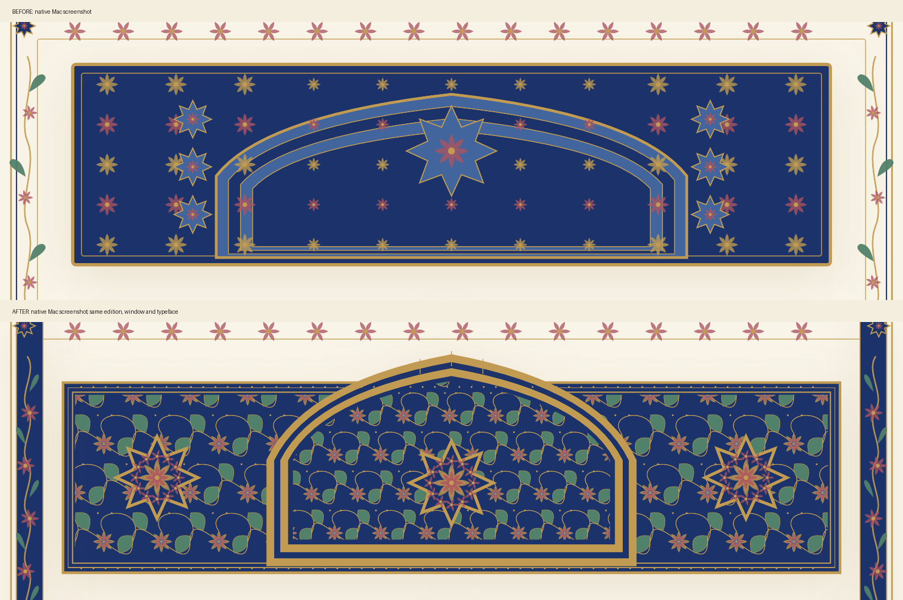
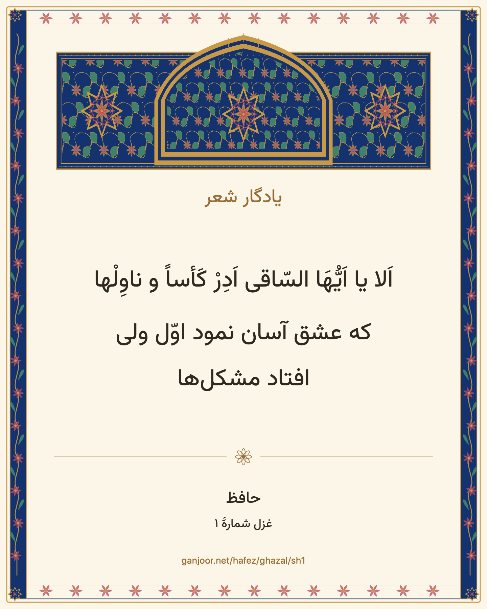
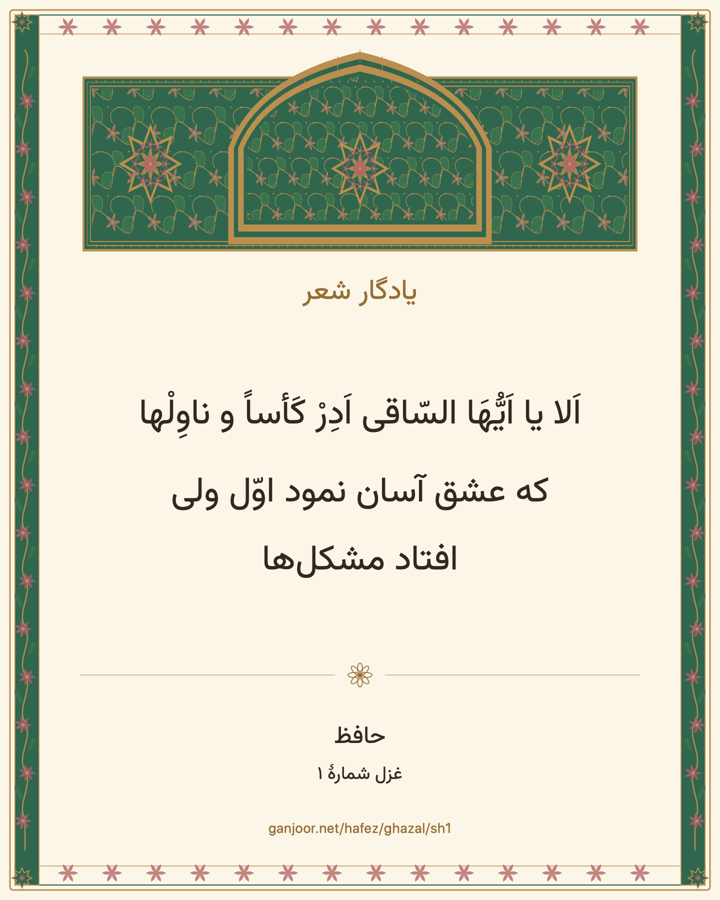
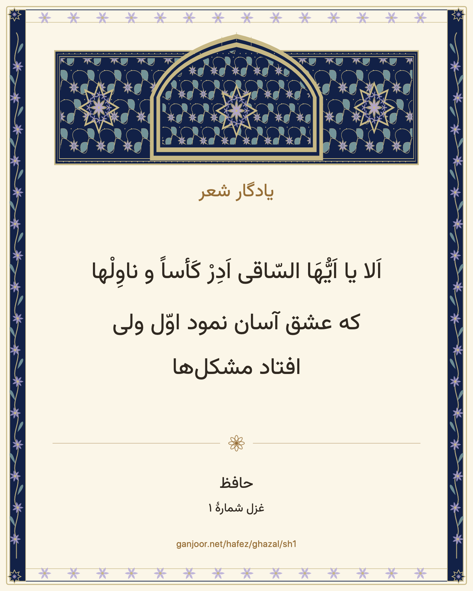

# Native manuscript QA — 5 November 2026

This is a substantial improvement over the branch baseline, **not a claim of complete fidelity approval**. The original historical reference uploads and three concept PNGs were not available in this chat, repository, or the project-related image files located during this session. The design contract, editable SVGs, palette tokens, Iranica ornamentation article and Met collection record were available. Comparing directly to the missing concepts remains an acceptance gate.

PR #17 had already merged at 21:23:32 UTC before this QA session started.
These follow-up changes are reviewed in [draft PR #18](https://github.com/Martin-Aziz/Arash_Kamangir/pull/18); this session did not merge either PR.

## Visible change

The baseline headpiece left large flat blue spaces between isolated flower stamps. The revised native headpiece fills the field and crown with connected gold tendrils, split leaves, layered blossoms, pearl edging and three intricate floral medallions. Pigment ribbons make the denser flowering side margins visible against ivory. The stacked hemistichs now have an intentional centered book composition. No artwork enters the text layout.

These are unretouched crops from the original full-window screenshots below. They are not concept art. The comparison uses Royal Lapis, Ivory, Vazirmatn 24 pt, 1220 pt window width on both sides. Full-window captures include the system shadow. Crop coordinates are the window's x=400…2040, y=275…780 at 2x.

## Actual reader captures

| Edition | Full library window, IranNastaliq 24 pt | Focus Mode, Vazirmatn 24 pt | Headpiece and margin detail |
|---|---|---|---|
| Royal Lapis | [Library](royal-library.png) | [Focus](royal-focus.png) | [Detail](royal-focus-detail.png) |
| Shiraz Garden | [Library](shiraz-library.png) | [Focus](shiraz-focus.png) | [Detail](shiraz-focus-detail.png) |
| Moonlit Divan | [Library](moonlit-library.png) | [Focus](moonlit-focus.png) | [Detail](moonlit-focus-detail.png) |

Additional evidence:

- [Royal Lapis with IranNastaliq 32 pt](royal-nastaliq-focus.png)
- [IranNastaliq 42 pt: verses clear of floral bands](nastaliq-42.png)
- [Constrained reader with Appearance Inspector](inspector-nastaliq.png)
- [920 pt library window](moonlit-library-920.png)
- [Quiet reading, IranNastaliq 42 pt](quiet-nastaliq.png)
- [Midnight, Vazirmatn 17 pt, source and ending](moonlit-midnight-17.png)
- [Baseline before this revision](before-royal-focus.png)

## Keepsake exports

Each file was exported through the actual Keepsake Studio Save PNG action, decoded, checked as exactly **1440×1800**, and visually inspected. All show Hafez sh1's first couplet with diacritics, poet, title and `ganjoor.net/hafez/ghazal/sh1`. Edition switching changed both the reader and subsequent export. The common text/palette was held constant to isolate the artwork comparison.

| Royal Lapis | Shiraz Garden | Moonlit Divan |
|---|---|---|
|  |  |  |

Canvas now renders synchronously, so export does not depend on an asynchronous drawing completion. Runtime text remains native and selectable; only explicit PNG export rasterizes the card.

## Verification

Environment: Apple Silicon, macOS 27.2 (26B123), Apple Swift 6.4.2. Worktree `/Users/martin/.codex/worktrees/4575/Arash_Kamangir`, based on PR #17 head `39edc64`. QA bundle `com.arashkam.reader.qa`, separately stored fonts/preferences/library.

| Check | Result |
|---|---|
| `python3 scripts/check-manuscript-design.py` | PASS for all three SVGs and native wiring |
| `swift test` | PASS, 16 tests, zero failures |
| `swift build` | PASS |
| `swift build -c release` | PASS |
| `bash scripts/package-macos.sh --qa` | PASS, local ad-hoc signed QA app |
| `codesign --verify --deep --strict dist/ArashKam-QA.app` | PASS |
| Hafez → ghazals → first poem | Verified canonical heading `/hafez/ghazal/sh1`, 7 couplets and source link |
| Template selection | All three reader editions, visual inspector thumbnails and subsequent exports checked |
| Narrow / normal | 920 and 1220 pt actual windows exercised; inspector constrains reader to 279 pt without horizontal text clipping |
| 1600 pt | Attempted using native preset; window exceeded this display's visible area and capture contained unrendered pixels. **Not visually certified** |
| Typefaces | Installed Vazirmatn and personally supplied IranNastaliq tested; personal font imported into QA store only, no font binary committed |
| Type extremes | IranNastaliq 17/42 pt and Vazirmatn 17/42 pt exercised; long sh1 lines wrap within reserved text area |
| Text selection | Drag-selected part of a live Persian verse; selected text appeared in accessibility output, no decoration intercepted it |
| Quiet | Verified ornament disappears and live poem remains readable |
| Reduced Motion | Enabled through system Accessibility → Motion; library/focus transition exercised; original off state restored |
| VoiceOver | Enabled through system settings; reader AX order exposes poet, title, verses and source, excludes all ornament; original off state restored. Spoken Persian pronunciation is **not listening-certified** |
| Font persistence | Imported IranNastaliq remained available after QA relaunch |
| User data | Original dirty checkout and all original personal font files left in place; no production poetry archive writes/deletions |

The new regression test checks text clearance for floral bands at page widths 545–629 pt. Previously those widths enabled the rich border but reserved only 26 pt for it. They now reserve 52 pt. The unused frame height warning was removed. Tests also retain canonical sh1/sh2 identity and app/font-store isolation checks.

A QA-only **Manuscript QA** menu sets exact 920/1220/1600×780 content sizes using AppKit. The production bundle does not expose it. It avoids relying on imprecise edge dragging for future screenshots.

## Remaining deviations and acceptance limits

1. Missing original uploads/concept PNGs prevent a direct reference-by-reference fidelity judgment. The comparison above is baseline app versus revised app. Do not substitute this for the requested concept comparison.
2. Ornament is original, mathematically repeated vector work. It does not reproduce hand-painted irregularity, burnished gold texture, miniature figural illustrations, asymmetrical botanical variation or historic paper grain. Gold is a flat accessible pigment, not a material simulation.
3. The editions share a crown architecture and scroll grammar. They differ in pigments, flower petal counts and central seal size; they are not three independently composed historical facsimiles. Shiraz foliage is deliberately subtle against green.
4. At page widths below 545 pt, the continuous floral side bands are omitted for text space. A compact illustrated crown and corner seals remain. At 42 pt, natural wrapping and taller Nastaliq metrics produce a long scrolling page; the whole poem is not forced onto one screen.
5. The 1600 pt fully visible window still needs a larger display. Reduced Transparency and a full keyboard-only journey were not separately certified in this session. VoiceOver needs a Persian-speaking listening review and deeper rotor/navigation testing.
6. Export quality was checked for the first sh1 couplet in all editions. Arbitrarily long poems/couplets beyond the observed sh1 content have not received exhaustive PNG layout testing; the pre-existing card's six-line limit remains a constraint.
7. The app remains locally ad-hoc signed, not notarized. No release was published and no merge was performed.

## Editable sources

- `Sources/ArashKam/PersianManuscriptTemplates.swift`: original reusable Canvas paths and components.
- `assets/templates/template-tokens.json`: edition palette and artboard/padding measurements.
- `assets/templates/*-headpiece.svg`: editable vector handoff art.
- `python3 scripts/generate-manuscript-svg.py`: deterministic regeneration from the tokens, mirroring the native path grammar. SVG handoff preserves the original 900×360 canvas and maps the native 900×260 artboard into it; it is not a runtime dependency.

Historical context: [Iranica, Calligraphic Ornamentation](https://www.iranicaonline.org/articles/calligraphy/calligraphy-iii-ornamentation/) describes parallel gold/blue rules, ornamented margins, symmetric headpieces and corner medallions. [The Met's 17th-century Anthology of Persian Poetry](https://www.metmuseum.org/art/collection/search/443198) documents ink, opaque watercolor and gold on paper. No historical scan was incorporated in the application.
